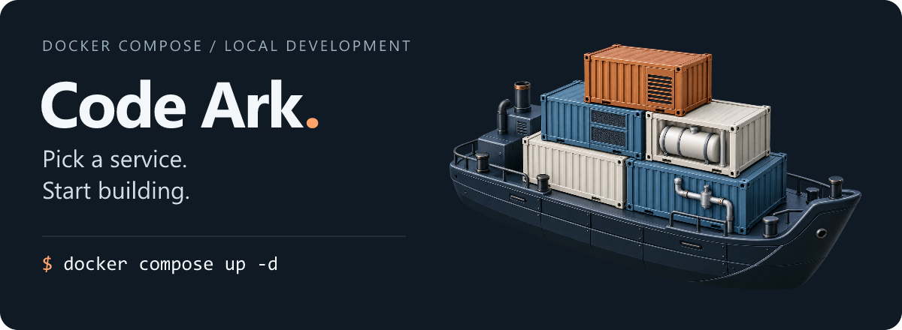

# Code Ark · Local infrastructure

<p align="center">
  
</p>

<p align="center">
  <a href="https://github.com/StephenQiu30/code-ark/stargazers"></a>
  <a href="https://github.com/StephenQiu30/code-ark/commits/main"></a>
  <a href="https://docs.docker.com/compose/"></a>
  <a href="./LICENSE"></a>
</p>

**Spend your setup time building your application.**

Code Ark brings together **17 Docker Compose configurations** for databases, caching, messaging, workflows, search, object storage, and monitoring. Choose a service directory and follow its setup instructions for local development, integration testing, or learning with Java, Go, Python, or Node.js.

[中文](./README.md) · [Quick start](#quick-start) · [Service catalog](#service-catalog) · [Daily use](#daily-use) · [Contribute](#contribute)

The [desktop toolbox design and implementation documents](./docs/00-文档导航.md) incorporate the one-click startup review. The desktop toolbox is being implemented in [toolbox/](./toolbox/README.md); it has not been released, and an isolated Redis source lifecycle has passed; full service and installer acceptance remain pending. The Compose configurations in the [service index](./services/README.md) remain the current way to use this repository.

## Quick start

Start with Redis: it does not need an `.env` file. You need **Docker Engine / Docker Desktop, Docker Compose v2 or later, and Git**.

```bash
git clone https://github.com/StephenQiu30/code-ark.git
cd code-ark/services/redis-start-local
docker compose up -d
docker compose exec redis redis-cli ping
```

A `PONG` response means your host application can connect to `localhost:6379`. Run `docker compose stop` when finished; AOF data is kept in the service's `data/` directory.

> Some services need environment variables, initialization SQL, or an existing database. Read the selected service's README first. You do not need to run the whole collection.

## Service catalog

The complete list of services, default ports, and prerequisites lives in [services/README.md](./services/README.md). Choose only what you need from the databases, caches, messaging, workflows, search, storage, and monitoring projects.

```text
services/    # 17 Compose projects and one host-tool guide
```

Before updating an existing clone, read the [migration notes](./services/README.md#从旧根目录布局迁移) and preserve your local configuration and data.

## Daily use

Run these commands inside the selected service directory:

```bash
docker compose ps -a           # Include one-shot initialization tasks
docker compose logs -f        # Follow logs
docker compose stop           # Stop containers
docker compose up -d          # Start again
docker compose down           # Remove this project's containers and networks
```

For services that need `.env`, copy `.env.example` **on the first run** and set your own values. Keep an existing `.env`; PowerShell users can use `Copy-Item .env.example .env`. Never commit passwords, tokens, or API keys.

<details>
<summary><strong>Will my data persist? How do application containers connect?</strong></summary>

- `stop` and ordinary `down` preserve persistent directories and named volumes. `down -v` deletes this project's named volumes, not host bind mounts or external databases.
- Host applications use published ports. Inside a container, `localhost` means that container; follow its service guide for service names, container ports, or host access.
- Start `pgsql-start-local` before Temporal. Canal reuses MySQL and requires ROW binlogging plus a replication account. Seata and XXL-Job need accessible MySQL databases and their metadata tables.
- Nacos uses the explicitly named volume `nacos-start-local-data`, created by Compose without `external: true`. `down -v` requests its removal; verify ownership and data before cleanup. See its guide.
- Start Elastic Stack with `./start.sh`. Its precheck requires at least 6 GB of Docker VM memory; use WSL or a compatible shell on Windows.

</details>

These configurations target local development and learning. Production deployment needs environment-specific authentication, TLS, backups, availability, and capacity planning. Some directories use `latest`; pin compatible versions when reproducibility matters.

## Contribute

Missing a service you use? [Request it](https://github.com/StephenQiu30/code-ark/issues/new) or add a template using the [contribution guide](./CONTRIBUTING.md). Startup fixes, documentation corrections, and practical feedback are welcome. Automation conventions live in [AGENTS.md](./AGENTS.md).

New commits and PR titles use `type(scope): description`, with a required scope, for example `docs(project): define repository structure`. See [PROJECT.md](./PROJECT.md) for directory responsibilities, [SHARING.md](./SHARING.md) for reuse and third-party licensing, [SECURITY.md](./SECURITY.md) for security reporting, and the [code of conduct](./CODE_OF_CONDUCT.md).

**If Code Ark saves you setup time, [give it a Star](https://github.com/StephenQiu30/code-ark).** Keep this toolbox handy for your next project.

## License

Repository configurations and documentation use the [MIT License](./LICENSE). Third-party software, images, and MediaCrawler remain subject to their own upstream licenses.
