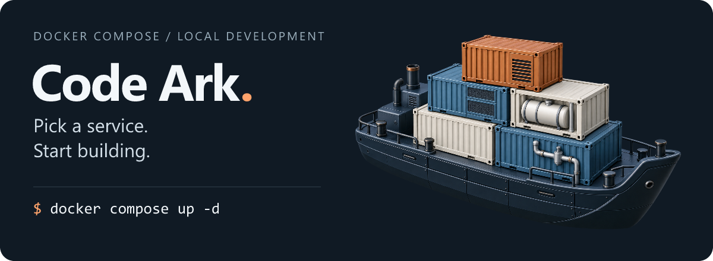

# Code Ark · 代码方舟

<p align="center">
  
</p>

<p align="center">
  <a href="https://github.com/StephenQiu30/code-ark/stargazers"></a>
  <a href="https://github.com/StephenQiu30/code-ark/commits/main"></a>
  <a href="https://docs.docker.com/compose/"></a>
  <a href="./LICENSE"></a>
</p>

**把搭建中间件的时间，留给写代码。**

Code Ark（代码方舟）收集了 **17 套 Docker Compose 配置**，覆盖数据库、缓存、消息队列、工作流、搜索、对象存储和监控。适合 Java、Go、Python、Node.js 开发者进行本地开发、接口联调和集成测试：选择需要的服务目录，按对应说明启动。

[English](./README.en.md) · [快速开始](#快速开始) · [服务目录](#服务目录) · [日常使用](#日常使用) · [参与贡献](#参与贡献)

[工作箱设计与实施文档](./docs/00-文档导航.md)已按一键启动审查修订。桌面工作箱已进入源码实施、尚未发行，相关运行验收均未执行；当前可用方式仍是[服务索引](./services/README.md)中的 Docker Compose 配置。

## 快速开始

先运行一个不需要 `.env` 的 Redis 示例。需要 **Docker Engine / Docker Desktop、Docker Compose v2 及以上版本，以及 Git**。

```bash
git clone https://github.com/StephenQiu30/code-ark.git
cd code-ark/services/redis-start-local
docker compose up -d
docker compose exec redis redis-cli ping
```

看到 `PONG`，就可以让本机应用连接 `localhost:6379`。用完运行 `docker compose stop`；Redis 的 AOF 数据保存在当前目录的 `data/` 中。

> 其他服务可能需要 `.env`、初始化 SQL 或已有数据库。每个目录的 README 都说明了自己的启动条件；无需同时启动整套环境。

## 服务目录

完整服务清单、默认端口与启动前置条件统一维护在 [services/README.md](./services/README.md)。数据库、缓存、消息、工作流、搜索、存储和监控均按目录选择，不需要启动整套环境。

```text
services/    # 17 套 Compose 配置与 1 份宿主机工具指南
```

已有克隆升级目录布局前，请先阅读 [迁移说明](./services/README.md#从旧根目录布局迁移)，保留本机配置和数据。

## 日常使用

在选定的服务目录中运行：

```bash
docker compose ps -a           # 容器状态，包括一次性初始化任务
docker compose logs -f        # 查看日志
docker compose stop           # 停止容器
docker compose up -d          # 再次启动
docker compose down           # 移除当前项目容器和网络
```

需要 `.env` 的服务，**首次**复制 `.env.example` 并填写自己的配置；已有 `.env` 时保留它。PowerShell 可使用 `Copy-Item .env.example .env`。密码、Token、API Key 不应提交到 Git。

<details>
<summary><strong>数据会保留吗？容器里的应用连接哪个地址？</strong></summary>

- `stop` 和普通 `down` 不删除持久化目录或命名卷。`down -v` 会删除本项目命名卷，不会删除宿主机绑定目录，也不会清空外部数据库。
- 宿主机应用使用发布端口；容器里的 `localhost` 指向容器自己，应按服务 README 使用服务名、容器端口或宿主机入口。
- Temporal 复用 `pgsql-start-local`，先启动 PostgreSQL。Canal 复用 MySQL，需启用 ROW binlog 并配置复制账号；Seata、XXL-Job 需要可访问的 MySQL 和对应表结构。
- Nacos 使用固定名称命名卷 `nacos-start-local-data`，由 Compose 创建，并未声明为外部卷；`down -v` 会请求删除该卷，清理前核对归属与数据。详情见其 README。
- Elastic Stack 建议通过 `./start.sh` 启动。脚本要求 Docker 虚拟机至少有 6 GB 内存，Windows 下使用 WSL / 兼容 Shell。

</details>

这些配置面向本地开发与学习。生产部署需结合实际环境补充认证、TLS、备份、高可用与容量规划；部分目录使用 `latest`，团队复现前可自行固定兼容版本。

## 参与贡献

缺一个你常用的服务？欢迎 [提交需求](https://github.com/StephenQiu30/code-ark/issues/new) 或按 [贡献指南](./CONTRIBUTING.md) 添加模板。修复启动问题、校准文档和分享使用反馈同样有帮助；自动化协作约定见 [AGENTS.md](./AGENTS.md)。

新提交与 PR 标题统一使用 `type(scope): 描述`，scope 必填，例如 `docs(project): 完善项目结构规范`。目录职责见 [PROJECT.md](./PROJECT.md)，公开复用与第三方许可边界见 [SHARING.md](./SHARING.md)；另提供 [安全报告政策](./SECURITY.md) 和 [社区行为准则](./CODE_OF_CONDUCT.md)。

**如果 Code Ark 帮你省下了搭建环境的时间，欢迎 [给项目一个 Star](https://github.com/StephenQiu30/code-ark)。** 收藏这份工具箱，下次搭建新项目时可以直接回来找需要的服务。

## License

仓库配置与文档采用 [MIT License](./LICENSE)。第三方软件、镜像及 MediaCrawler 的使用需分别遵循各自上游许可。
